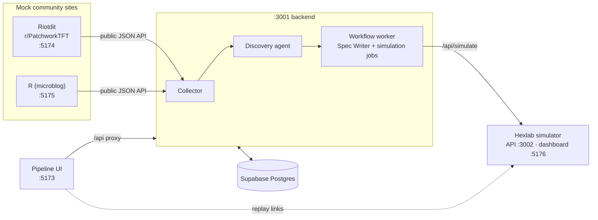

# Patchwork

**Turn player feedback into measured, human-approved balance experiments.**

Patchwork is a DevHacks 2026 project for the Riot track (Prompt 02 · Agentic Development). It collects player complaints from community sites, groups them into issues with an LLM, drafts a numeric balance patch for an issue, and tests that patch in a deterministic auto-battler simulator. Every step that changes the outcome needs a person to approve it. Agents propose; people decide.



## What's in the repo

| Directory | What it is | Stack |
|---|---|---|
| [`backend/`](backend/README.md) | The authority for workflow state. Collects feedback, runs Discovery and the Spec Writer, queues Hexlab simulations, and records human decisions. | Node 22 · Express 5 · `pg` · Zod · OpenAI Responses API |
| [`ui/`](ui/README.md) | **Pipeline UI.** The tracker people work in: Board, List, issue evidence, spec review, test results, decisions. | Vite 8 · React 19 · React Router 7 · Tailwind 4 · Recharts |
| [`tft-clone/`](tft-clone/README.md) | **Hexlab.** A small, deterministic auto-battler with a balance-experiment API and replay dashboard. | Vite · React · Express · Zod · Vitest |
| [`mockreddit/`](mockreddit/README.md) | **Riotdit.** A mock subreddit that serves Reddit-shaped JSON. Judges can post into it live. | Vite · React · Express · Supabase |
| [`mockr/`](mockr/README.md) | **R.** A mock microblog that serves X API v2-shaped JSON. | Vite · React · Express · Supabase |
| [`supabase/`](supabase/migrations/README.md) | SQL migrations for every schema (`public`, `mockreddit`, `mockr`). | Postgres |
| [`scripts/`](scripts/start.mjs) | `start.mjs`, the one-command launcher for all five apps. | Node |
| [`docs/`](docs/README.md) | Architecture, API reference, workflow, database, and operations guides. | Markdown |

## Quick start

You need **Node.js 22.12+**, a hosted Supabase project, and (for Discovery and the Spec Writer) an OpenAI API key with billing enabled.

```bash
# 1. Environment
cp .env.example .env                    # VITE_SUPABASE_URL, VITE_SUPABASE_ANON_KEY
cp backend/.env.example backend/.env    # SUPABASE_DB_URL, OPENAI_API_KEY, OPENAI_MODEL

# 2. Dependencies (once, and again whenever a package-lock.json changes)
for app in backend ui mockreddit mockr tft-clone; do npm --prefix "$app" ci; done

# 3. Everything, in one terminal
./scripts/start.mjs
```

| App | URL |
|---|---|
| Pipeline UI | http://127.0.0.1:5173 |
| Riotdit | http://127.0.0.1:5174/r/PatchworkTFT |
| R | http://127.0.0.1:5175 |
| Hexlab dashboard | http://127.0.0.1:5176 |
| Backend API | http://127.0.0.1:3001 (`API_PORT`) |
| Hexlab API | http://127.0.0.1:3002/api (`HEXLAB_API_URL`) |

Before the first run, apply the database migrations. **Read the [migration guide](supabase/migrations/README.md) first:** the shared hosted project already has some of them, and replaying old migrations there is destructive.

The full walkthrough is in **[Getting started](docs/getting-started.md)**.

> [!WARNING]
> Once `OPENAI_API_KEY` and `OPENAI_MODEL` are set, the backend's polling worker makes **billable** model calls on its own whenever new feedback arrives. Set a budget on your OpenAI project.

## How it works

1. **Collect.** Every few seconds the backend reads the two mock sites through their public HTTP APIs. It follows pagination, keeps comment threads intact, and respects rate-limit headers.
2. **Discover.** New or changed feedback goes into a queue. The Discovery agent groups it into issues ("Yasuo feels too strong") and may only cite feedback IDs it was given.
3. **Triage.** People assign a developer, edit titles and tags, comment, merge duplicates, or dismiss noise in the Pipeline UI.
4. **Specify.** Starting an experiment freezes the issue's evidence and the exact Hexlab baseline. The Spec Writer drafts a markdown spec and a structured numeric patch, such as `yasuo.attackDamage: 25 → 20`. People edit it, ask for revisions, approve it, or reject it.
5. **Simulate.** Approving the spec queues a Hexlab job. Baseline and patched configurations play exactly the same seeded matchups, and the result is checked against the request before it is saved.
6. **Decide.** A reviewer accepts or rejects the experiment against a specific spec version and simulation. Finishing a run does not count as accepting it.

The lifecycle, its guards, and how retries work are covered in **[Experiment workflow](docs/workflow.md)**.

## Documentation

| Guide | Covers |
|---|---|
| [Getting started](docs/getting-started.md) | First-time setup, from an empty Supabase project to a running demo |
| [Architecture](docs/architecture.md) | Components, data flow, trust boundaries, design principles |
| [Configuration](docs/configuration.md) | Every environment variable, by app |
| [Backend internals](docs/backend.md) | Workers, Discovery, Spec Writer, Hexlab client, artifact store |
| [Backend API reference](docs/api/backend-api.md) | Every endpoint, with request bodies, responses, and error codes |
| [Experiment workflow](docs/workflow.md) | Lifecycle state machine, optimistic concurrency, idempotency |
| [Database](docs/database.md) | Schemas, tables, and what writes each one |
| [Development & testing](docs/development.md) | Test suites, conventions, repository layout |
| [Troubleshooting](docs/troubleshooting.md) | Common failures and fixes |
| [Live tracker read contract](docs/contracts/tracker-http-examples.md) | The read-only contract the UI relies on |
| [Hexlab API](tft-clone/README.md#agent-api) | Simulator endpoints and methodology |
| [Riotdit API](mockreddit/API.md) · [R API](mockr/API.md) | Source-site public APIs |

## Project status

| Area | Status |
|---|---|
| Collection from Riotdit and R | Working; covered by tests |
| Discovery (LLM grouping) | Working once OpenAI credentials are configured |
| Issue triage (assign, edit, comment, dismiss, restore, merge) | Backend complete; UI connected |
| Numeric experiments (spec → approve → simulate → decide) | Backend complete (migrations `0007`–`0008`); UI pages connected, end-to-end walkthrough still being validated |
| Legacy source-code run path (`BASELINE_REVISION`, `SCENARIO_MANIFEST`) | Kept for compatibility; not the main path |
| Deploying an accepted patch | Not implemented (`/capabilities` reports `deployment: disabled`) |

## Security notes

- The backend binds only to loopback and refuses any other `API_HOST`. It has no authentication; it is a local development tool.
- `SUPABASE_DB_URL` and `OPENAI_API_KEY` are server-only. Never put them in a `VITE_*` variable or in the repository-root `.env`.
- The browser anon key can do what the source apps intend (post, vote, read) but cannot write workflow tables. Row-level security and grants enforce this.
- All player text is handled as **untrusted data**. Both LLM prompts say so, model outputs are schema-checked and every cited ID is verified, and the UIs render source text as plain text.

## Notes for agents

Mobile accessibility doesn't matter here. This is a desktop dev tool.

## Riot notice

Patchwork and Hexlab are independent hackathon prototypes. Riot Games does not endorse them. See [`tft-clone/README.md`](tft-clone/README.md#independent-prototype-notice) and the asset note in [`ui/SIMULATOR.md`](ui/SIMULATOR.md#riot-assets).
