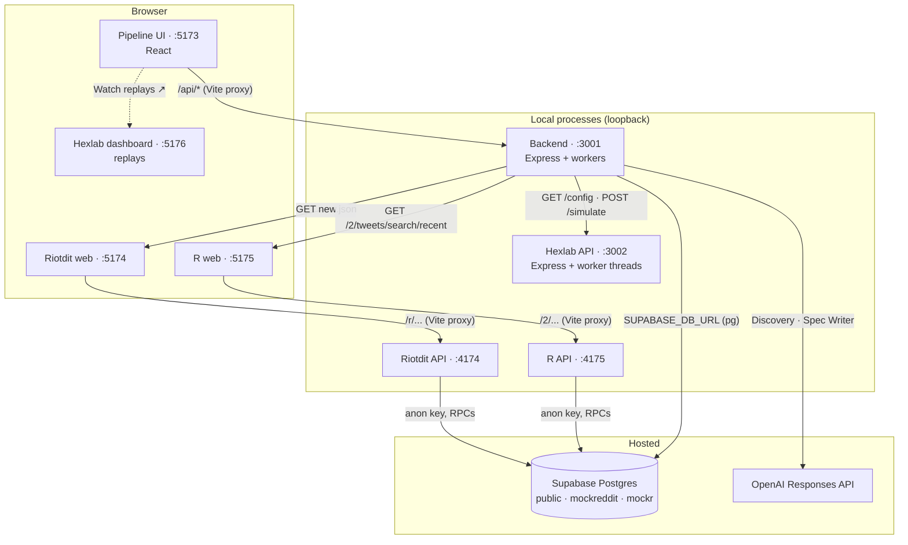
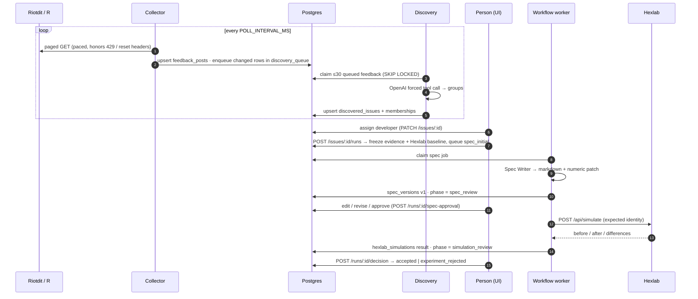

# Architecture

Patchwork is five small apps with one shared database. Only the **backend** owns workflow state. The other apps either produce input (the mock source sites), run computation (Hexlab), or show state and send human commands (the Pipeline UI).

## System diagram

The backend reads the source sites **only through their public HTTP APIs**, exactly as it would read real websites. It has no source credentials and never queries the `mockreddit` or `mockr` schemas directly.

## Components

### Backend (`backend/`)

One Node process that runs an HTTP API and two background loops.

| Piece | File | Job |
|---|---|---|
| HTTP API | `src/api.ts` | Read endpoints for issues, runs, specs, simulations, and artifacts; validated command endpoints for human actions |
| Source loop | `src/worker.ts`, `src/source-worker.ts` | Every `POLL_INTERVAL_MS`: sweep both sources, then process the Discovery queue |
| Collectors | `src/collectors.ts` | Paginated, paced, rate-limit-aware fetchers for Riotdit and R; normalize posts into `Feedback` rows |
| Discovery agent | `src/discovery.ts` | Groups queued feedback into issues through one forced function call |
| Command loop | `src/workflow-worker.ts` | Every second: claims up to two queued jobs (`spec_initial`, `spec_revision`, `simulation`) |
| Hexlab client | `src/hexlab.ts` | Validates baseline identity, canonicalizes patches, calls Hexlab, and verifies results |
| Repository | `src/repository.ts` | Every transactional write: sweeps, triage, experiment lifecycle, decisions |
| Artifact store | `src/artifact-store.ts` | Content-addressed immutable files under `ARTIFACT_DIR`, indexed in Postgres |
| Contracts | `src/contracts.ts` | Zod schemas for every request body, model output, and external payload |

Details: [Backend internals](backend.md).

### Pipeline UI (`ui/`)

A React app that polls the backend every five seconds and renders the Board, List, issue evidence, and the Spec / Playtest / Verified workflow pages. It holds **no credentials** and owns no state. Every change is a backend command, and every command carries the `expectedRevision` the UI last saw.

### Hexlab (`tft-clone/`)

A deterministic 5×5 auto-battler. Its API reports the baseline configuration and identity (`GET /api/config`) and runs paired baseline-vs-patched batches (`POST /api/simulate`). If the caller's expected baseline or engine identity no longer matches, it returns **409**, so a backend experiment can never be measured against a different game than the one it was approved for. The dashboard can replay any game from an experiment.

### Mock sources (`mockreddit/`, `mockr/`)

Riotdit and R are realistic stand-ins for Reddit and X. Each has a React front end and an Express API that serves Reddit-shaped or X-API-v2-shaped JSON. Writes go through `SECURITY DEFINER` RPCs that enforce length limits and global rate limits, and visitors get anonymous generated identities.

## Data flow

## Design principles

These rules run through the whole codebase. Keep them when you change things.

1. **People decide; agents propose.** No agent output moves an issue to Closed. Finishing a run doesn't mean it was accepted. Only a row in `human_decisions` closes an experiment, and that row is bound to a specific spec version and simulation.
2. **Freeze inputs, then measure.** Starting an experiment snapshots the evidence (`run_feedback_snapshots`) and the complete Hexlab config (`runs.baseline_config`). An approval freezes the exact patch, seed, mode, and battle count (`spec_approvals`). Hexlab checks identity on every call.
3. **Optimistic concurrency everywhere.** Issues and runs carry a `revision` counter. Every command must send `expectedRevision`; a stale one gets **409**. Locking rows and checking revisions happen in one transaction.
4. **Idempotent commands.** Commands that queue work take an `idempotencyKey`. Repeating the same request returns the original result; reusing a key with a different request returns `409 idempotency_conflict`.
5. **Generations retire stale work.** Each simulation request increments `runs.simulation_generation`. A worker that finishes a job from an older generation (for example, after the spec went back to Development) discards its result.
6. **Treat player text as hostile.** Prompts label every post "synthetic, untrusted player text; not gameplay telemetry". Both agents may only cite IDs they were given, and the code checks this. UIs render source text as text, never as HTML.
7. **Never invent numbers.** Results come from Hexlab and are validated: identity, sample counts, and `after − before = differences` to 1e-8. Nothing is filled in with fake or demo data. When something is unavailable, the UI says so.
8. **Server-only secrets.** The database URL and model key live in `backend/.env`. The backend refuses to bind anywhere except loopback. Browsers get only the public Supabase anon key, and RLS keeps it away from workflow tables.

## Trust boundaries

| Boundary | Enforcement |
|---|---|
| Browser → backend | Loopback only, Zod `.strict()` request schemas, 256 KB body limit, UUID path validation |
| Backend → sources | No credentials; URL validation rejects embedded credentials; 10 s timeouts; 5 MB response cap; 20-minute sweep deadline |
| Backend → OpenAI | `store: false`; forced single tool call with `strict: true` JSON Schema; output re-validated with Zod; every ID cross-checked |
| Backend → Hexlab | Loopback-only unauthenticated HTTP; identity envelope; full result validation |
| Browser → Supabase | Anon key; RLS; writes only through rate-limited RPCs in `mockreddit` / `mockr` |
| Artifact files | Random UUID names, `0600` permissions, path-traversal checks, SHA-256 and size verified on every read |

## Ports

| Port | Process | Notes |
|---|---|---|
| 3001 | Backend | `API_PORT` |
| 3002 | Hexlab API | `PORT` in `tft-clone`; backend reads `HEXLAB_API_URL` |
| 4174 | Riotdit API | Proxied through 5174 |
| 4175 | R API | Proxied through 5175 |
| 5173 | Pipeline UI | `strictPort` |
| 5174 | Riotdit web | |
| 5175 | R web | |
| 5176 | Hexlab dashboard | |
