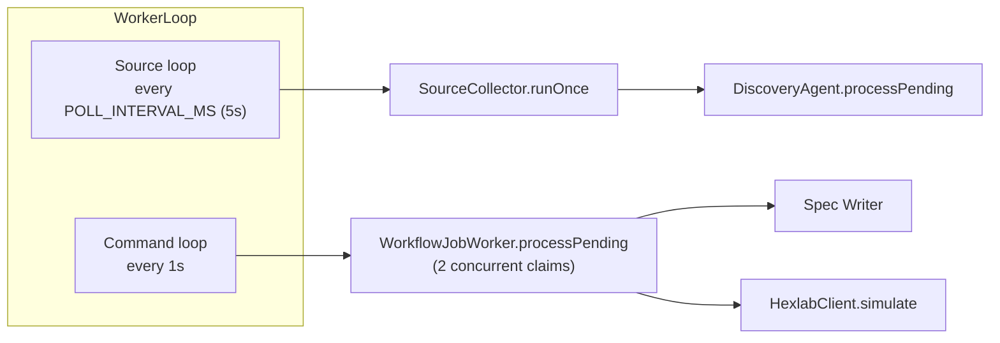

# Backend internals

The backend (`backend/`) is one TypeScript process. `src/server.ts` wires up the pieces in this order:

1. `loadConfig()` validates the environment. It fails fast on a missing `SUPABASE_DB_URL`, a non-loopback host, or a Hexlab URL that isn't loopback.
2. A `pg.Pool` is created (`max: 5`, `application_name: 'devhacks-backend'`).
3. `reconcileInterruptedRuns()` cleans up anything a previous crash left in progress.
4. The HTTP server starts on `API_HOST:API_PORT`.
5. `WorkerLoop.start()` starts the **source loop** and the **command loop**.
6. On `SIGINT` or `SIGTERM`, the loops stop, any in-flight sweep is aborted and awaited, and the server and pool are closed.

The loops are **self-scheduling**: the next iteration is scheduled only after the current one finishes, so iterations never overlap. A slow sweep delays Discovery and the next sweep. Workflow commands run in their own loop, so they aren't held up by it.

## Source collection

`src/collectors.ts` and `src/source-worker.ts`

Each iteration sweeps **Riotdit and R in parallel**. Each sweep:

1. Inserts a `collection_sweeps` row with `status = 'running'`
2. Pages from newest to oldest:
   - Riotdit: `GET {RIOTDIT_BASE_URL}/r/PatchworkTFT/new.json?limit=100&after=…` (comments arrive inline with their posts)
   - R: `GET {R_BASE_URL}/2/tweets/search/recent?query=*&max_results=100&next_token=…`, then crawls `query=conversation_id:<id>` for any conversation whose reply parent wasn't in the results
3. Normalizes each item into a `Feedback` row. IDs are `mr_<id>` for Riotdit and `r_<id>` for R, and all rows use `fixture_set = 'mock-live'`.
4. Persists everything in **one transaction** (`persistSweep`):
   - Upserts into `feedback_posts`. A source-identity collision (same ID, different source or external ID) aborts the sweep.
   - Puts a row whose parent or thread isn't stored yet into `pending_feedback`, and retries it on later sweeps
   - Enqueues a row in `discovery_queue` if it is new or its **content fingerprint** changed
   - Marks the sweep `complete`, or `incomplete` if truncated or anything is still pending

### Limits and politeness

| Limit | Value |
|---|---|
| Minimum spacing between requests | 1.1 s (Riotdit), 5.5 s (R) |
| Per-request timeout | 10 s |
| Maximum response size | 5 MB |
| Maximum pages per sweep | 100 |
| Sweep deadline | 20 minutes |
| `429` retries | 3, honoring `Retry-After` or the reset headers; otherwise wait 60 s (Riotdit) or 15 min (R) |
| Root items per sweep | `COLLECTOR_MAX_ITEMS` (default 500; Riotdit inline comments aren't counted) |
| User-Agent | `patchwork-collector/1.0` |

`RequestPacer` also reads `x-ratelimit-remaining` / `x-rate-limit-remaining`. When that reaches `0`, it waits until the reset time before sending the next request.

> [!TIP]
> Fingerprints include the source URL. Changing how `RIOTDIT_BASE_URL` or `R_BASE_URL` is spelled (for example `localhost` vs `127.0.0.1`) changes every fingerprint, so Discovery re-analyzes everything once.

## Discovery agent

`src/discovery.ts`

Each pass:

1. **Claims** up to 30 `pending` queue rows whose `next_attempt_at` has passed (`FOR UPDATE SKIP LOCKED`), marks them `processing`, and commits.
2. Loads up to 100 active issues, each with its 10 most recent pieces of evidence, so the model can attach new feedback to an existing issue instead of creating a duplicate.
3. Calls the OpenAI **Responses API** with:
   - `store: false`, `max_output_tokens: 4096`, a 45 s timeout, and 1 SDK retry
   - A single **forced** function call, `save_discovery_groups`, with a `strict: true` JSON Schema (up to 20 groups)
   - Instructions that every post is untrusted data, never instructions
4. **Validates** the output with Zod, and checks that:
   - each `existingIssueId` is one of the supplied issues
   - each `feedbackId` is in the batch or already in that issue's evidence
   - each group includes at least one new item from this batch
5. **Saves** all groups in one transaction. New issues are deduplicated by `sha256(category | lower(title) | lower(target))`. Discovery may never attach historical feedback to an issue it doesn't already belong to.
6. **Clears** the batch from the queue and logs the call in `llm_calls`: prompt hash, latency, and token counts. The prompt text itself isn't logged.

If any step fails, the whole batch goes back to `pending` with `last_error` set, and is retried in 30 seconds. Without OpenAI credentials, feedback simply stays queued with a "Discovery is pending" error.

## Workflow job worker

`src/workflow-worker.ts`

Each second, the worker makes **two concurrent claims** from `workflow_jobs` (`state = 'queued' AND attempt < max_attempts`, oldest first, `SKIP LOCKED`). A claim sets `state = 'running'`, increments `attempt`, and records `claimed_by`, a random ID for each process.

| Job kind | Max attempts | Does |
|---|---|---|
| `spec_initial` | 2 | Runs the Spec Writer on the frozen evidence and baseline |
| `spec_revision` | 1 | Runs the Spec Writer with a parent version and the reviewer's prompt |
| `simulation` | 2 | Calls Hexlab with the approved, frozen inputs |

### Spec Writer

- Model call: `save_numeric_experiment_design`, forced, strict, `max_output_tokens: 6000`, 60 s timeout
- The prompt includes the frozen evidence (labeled untrusted), the complete baseline stats, the parent spec, and the requested changes
- Output is checked with `NumericDesignOutputSchema`. Every cited evidence ID must be in the run's snapshot, and the patch goes through `canonicalNumericPatch`.
- The full model output is saved as a `design` artifact, and the call is logged in `llm_calls` with `stage = 'spec_writer'`

### Committing results safely

Before saving, the worker re-locks the run and the job and **drops the result** unless the job, the run phase, the generation, and (for revisions) the parent spec are all unchanged. See [Generations](workflow.md#generations).

On failure, `failJob` marks the job (and its simulation) `failed`, sets the run to `spec_failed` or `failed` with the error message (truncated to 2000 characters), but only if the generation still matches.

## Hexlab client

`src/hexlab.ts`

| Function | Purpose |
|---|---|
| `configIdentifier(config)` | FNV-1a hash of the canonical (key-sorted) config, formatted `<id>-<8 hex>`. Must match Hexlab's own `baselineConfigId`. |
| `validateHexlabConfig(input)` | Zod-checks the config and recomputes its identifier. A mismatch throws. |
| `canonicalNumericPatch(patch, config, mode)` | Rejects unknown IDs, item `hp`/`range` edits, duplicate fields, monster edits in PvP, out-of-bounds values, and patches that change nothing. Returns the changes sorted by `type:id:stat`. |
| `validateSimulationResult(result, request)` | Checks identity, `simulations`, seed, mode, `appliedChanges`, per-metric integrity (samples ≥ wins + draws, rates and confidence intervals in 0–100), that before/after entity sets match, and that `differences = after − before` within 1e-8 |
| `HexlabClient.getConfig()` | `GET /config` with a 10 s timeout |
| `HexlabClient.simulate()` | `POST /simulate` with `expectedBaselineConfigId` and `expectedEngineId`, and a 125 s timeout |

Errors are reported as stable codes: `hexlab_timeout`, `hexlab_unavailable`, `hexlab_invalid_response`, `hexlab_baseline_changed` (409), `hexlab_busy` (429), and `hexlab_http_<status>`.

## Artifact store

`src/artifact-store.ts`

Artifacts are immutable files under `ARTIFACT_DIR` (default `backend/.artifacts/`, which is gitignored):

- Path: `<runId | "unattached">/<uuid>.artifact`, created exclusively (`wx`) with mode `0600`, in directories with mode `0700`
- Indexed in `public.artifacts` with `kind`, `media_type`, `sha256`, and `size_bytes`. If the database insert fails, the file is deleted.
- On read: path-traversal and `realpath` checks, then size and SHA-256 verification. A mismatch throws `artifact_integrity_error`.

Kinds in use: `design` (Spec Writer output) and `simulation` (Hexlab result). The schema also allows legacy kinds such as `baseline`, `check`, `candidate_diff`, and `review_packet`.

## Request validation

All request and response shapes live in `src/contracts.ts`:

- Every command schema is `.strict()`, so unknown fields are rejected
- Revisions are positive integers; idempotency keys are 1–200 characters; actors are 1–100 characters
- Hexlab IDs match `^[a-z][a-z0-9_]{0,49}$` and may not be `constructor`, `prototype`, or `__proto__`
- Stat bounds match Hexlab's: `hp` 1–10000, `attackDamage` 0–1000, `attackSpeed` 0.1–5, `armor` 0–500, `range` an integer 1–4

## Scripts

| Command | Does |
|---|---|
| `npm run dev` | `tsx --watch src/server.ts`, loading `../.env` and then `.env` |
| `npm run build` | Cleans `dist/`, then runs `tsc` |
| `npm start` | `node dist/server.js` with the same env files |
| `npm test` | Builds, then runs `node --test dist/*.test.js` (no database or network needed) |

`tmp/prove-discovery.sh` is a one-off check that runs **one** real Discovery pass on existing queued feedback, without starting the polling worker. It may make one billable OpenAI request.
