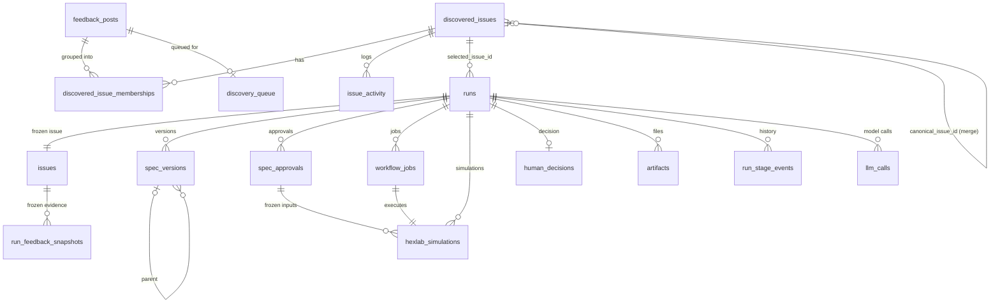

# Database

Patchwork uses one hosted **Supabase Postgres** project with three schemas:

| Schema | Owner | Accessed by |
|---|---|---|
| `public` | Backend | The backend over `SUPABASE_DB_URL`. Browsers can't write workflow tables. |
| `mockreddit` | Riotdit | The Riotdit API server and web app, through the anon key and RPCs |
| `mockr` | R | The R API server and web app, through the anon key and RPCs |

Migrations live in [`supabase/migrations/`](../supabase/migrations/README.md). `supabase/schema.sql` is a snapshot captured on 2026-11-14. It is meant **only for a new, empty project**, refuses to run against an existing one, and predates migrations `0007`–`0008`.

## Entity overview



## `public` tables

### Collection

| Table | Purpose | Written by |
|---|---|---|
| `feedback_posts` | Every collected post, comment, reply, and tweet. Key: `mr_<id>` / `r_<id>`. Unique on `(fixture_set, source, external_id)`. Includes `content_fingerprint`, `parent_id`, and `thread_id`. | Collector |
| `pending_feedback` | Replies whose parent or thread isn't stored yet. Retried on every sweep. | Collector |
| `collection_sweeps` | One row per sweep and source: `status`, `pages`, `items`, `truncated`, `error`, timestamps | Collector |

### Discovery and triage

| Table | Purpose | Written by |
|---|---|---|
| `discovery_queue` | Feedback waiting for Discovery: `pending` or `processing`, with `attempts`, `next_attempt_at`, `last_error` | Collector (enqueue), Discovery (claim and clear) |
| `discovered_issues` | Issue groups: agent fields (`title`, `summary`, `category`, `target`, `tags`) and human fields (`human_title`, `human_tags`, `assigned_developer`, `triage_state`, `canonical_issue_id`, `dismissed_*`), plus `revision` and a unique `fingerprint` | Discovery, triage commands |
| `discovered_issue_memberships` | Many-to-many link between issues and feedback | Discovery, merge |
| `issue_activity` | Append-only audit log for each issue | Every triage and workflow command |
| `llm_calls` | One row per model call: `stage` (`discovery` / `spec_writer`), prompt hash, latency, tokens, success, error | Discovery, Spec Writer |

### Experiments

| Table | Purpose |
|---|---|
| `runs` | One row per experiment: `experiment_kind`, `lifecycle_phase`, `status`, `revision`, `simulation_generation`, the frozen `baseline_config`, `baseline_config_id`, `engine_id`, `current_spec_version_id`, `approved_spec_version_id`, `idempotency_key`, `request_hash` |
| `issues` | The frozen copy of the selected issue, keyed by `(run_id, id)`, with post IDs, quotes, and an evidence summary |
| `run_feedback_snapshots` | The frozen JSON payload of every feedback row as it was when the experiment started |
| `spec_versions` | Immutable versions: `version_number`, `parent_version_id`, `author_kind` (`ai` / `human`), `markdown`, `structured_spec`, `numeric_patch`, `prompt`, `model_output`, `model_call_id`, `design_artifact_id` |
| `spec_approvals` | Frozen approved inputs: patch, seed, mode, battles, baseline. Only **one** `approved` row per run (partial unique index); older ones become `invalidated`. |
| `workflow_jobs` | Durable job queue: `kind`, `state` (`queued`, `running`, `succeeded`, `failed`, `interrupted`, `retired`), `generation`, `attempt` / `max_attempts`, `idempotency_key`, `request_hash`, `input`, `result`, `claimed_by`, `last_retry_*` |
| `hexlab_simulations` | One row per simulation request, with its validated `result` |
| `human_decisions` | At most one per run: `decision`, `reviewer`, `comment`, the bound `spec_version_id` / `simulation_id` / `candidate_identity`, and `request_hash` |
| `artifacts` | Index of immutable files on disk: `kind`, `relative_path`, `media_type`, `sha256`, `size_bytes`, `logical_path` |
| `run_stage_events` | Stage history for each run (used mostly by the legacy path) |

### Legacy (from `0001`)

`balance_versions`, `specs`, `attempts`, `playtest_reports`, `quarantined_posts`, `seed_sets_public`, and `private.seed_sets` belong to the original run-centric design. The live tracker doesn't use the old UI tables (`ui_issue_meta`, `ui_source_status`, `ui_ingest` in `ui/supabase/`).

## Source schemas

### `mockreddit`

`posts` and `comments` (replies are one level deep). Writes go through RPCs only: `submit_post`, `submit_comment`, `vote`, and `listing`. Limits: titles 1–300 characters, bodies up to 2000; globally, 20 posts and 40 comments per minute. Details: [`mockreddit/README.md`](../mockreddit/README.md).

### `mockr`

`posts`, with replies through `reply_to_id`. RPCs: `submit_post`, `like`, `repost`, and `search_recent`. Limits: posts 1–280 characters; globally, 20 posts per minute. Details: [`mockr/README.md`](../mockr/README.md).

Clearing live demo posts while keeping the seed data:

```sql
delete from mockr.posts where not is_seed;
```

## Security model

- **RLS is on** for every workflow table, and `anon` / `authenticated` have no privileges on them. The backend connects as a database user over `SUPABASE_DB_URL`.
- The source schemas give `anon` read access plus `EXECUTE` on their RPCs. Direct `INSERT` and `UPDATE` are blocked.
- Integrity is enforced in the schema with `CHECK` constraints (state enums, length limits, seed range, battle counts, the `triage_state = 'merged' ⇔ canonical_issue_id IS NOT NULL` rule) and composite foreign keys (for example, `(run_id, spec_version_id)`), so one run can't point at another run's spec.

## Useful queries

```sql
-- Latest sweep per source
select distinct on (source) source, status, items, error, started_at
from public.collection_sweeps order by source, started_at desc;

-- Discovery backlog and failures
select state, count(*), max(last_error) from public.discovery_queue group by state;

-- Active experiment, if any
select id, lifecycle_phase, revision, simulation_generation, error
from public.runs
where experiment_kind = 'hexlab_numeric'
  and lifecycle_phase not in ('accepted', 'experiment_rejected', 'spec_rejected');

-- Model spend, roughly
select stage, count(*), sum(input_tokens), sum(output_tokens), avg(latency_ms)::int
from public.llm_calls group by stage;
```
