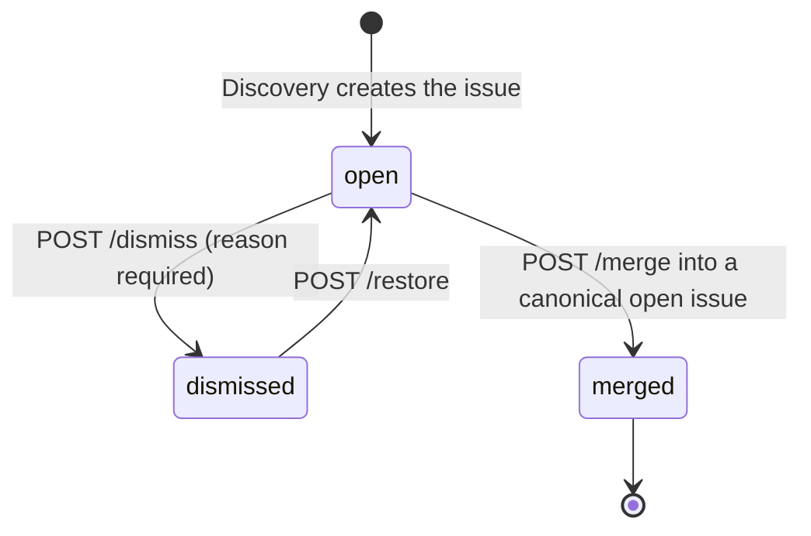
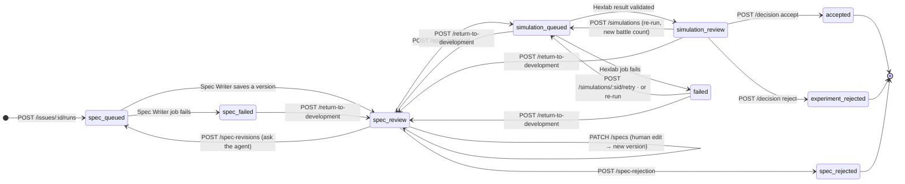

# Experiment workflow

This page explains how a discovered issue becomes a measured, human-reviewed **numeric Hexlab experiment** (`experiment_kind = 'hexlab_numeric'`). All of these rules are enforced by the backend, in `backend/src/repository.ts` and `backend/src/workflow-worker.ts`. The UI only reflects them.

## Two state machines

There are two independent state machines:

- **Issue triage**: `discovered_issues.triage_state`
- **Experiment lifecycle**: `runs.lifecycle_phase`

Dismissing an issue does not reject an experiment, and rejecting an experiment does not dismiss the issue.

### Issue triage



- **Merge** copies the source issue's feedback into the canonical issue. The source's `triage_state` becomes `merged` and `canonical_issue_id` is set. You can't merge an issue into itself, into an issue that is already merged, or while either issue has an active experiment.
- Discovery may update an issue's title, summary, and tags. People set **`human_title`** and **`human_tags`**, which take precedence on reads (`coalesce(human_title, title)`), so the next Discovery pass doesn't overwrite your edits.
- Every triage action appends an `issue_activity` row (who did it, what, and when).

### Experiment lifecycle



**Terminal phases:** `accepted`, `experiment_rejected`, `spec_rejected`. A terminal experiment can't be changed, and `return-to-development` answers `409 experiment_finalized`.

**How phases map to the UI's columns:**

| Board column | Lifecycle phases (from `mapIssue` in `ui/src/data/live.js`) |
|---|---|
| Issues | No run yet, or the latest run is `spec_rejected` (shown as "Spec rejected"; a new experiment can be started) |
| Development | `spec_queued`, `spec_review`, `spec_failed` |
| Testing | `simulation_queued`, `simulation_review`, and `failed` after an approval |
| Closed | `accepted`, `experiment_rejected`, or a dismissed issue |

> [!NOTE]
> **Known issue:** `mapIssue` also sends any run whose `status` is `review` to Testing, and the backend sets `status = 'review'` during `spec_review`. As a result, a spec awaiting review currently shows in the Testing column instead of Development. Checking `phase.startsWith('spec_')` before the `status` fallback would fix it.

`runs.status` (`queued`, `review`, `verifying`, `failed`, `done`, …) is a coarser legacy field kept in sync with each phase. Use `lifecycle_phase` for numeric experiments.

## Step by step

### 1. Start an experiment

`POST /issues/:issueId/runs` with `{ idempotencyKey, actor }`.

Preconditions, all checked inside one transaction under an advisory lock:

- `OPENAI_API_KEY` and `OPENAI_MODEL` are set (otherwise `503 spec_writer_not_configured`)
- Hexlab is reachable and its config passes validation (otherwise `503 hexlab_unavailable`)
- The issue exists, its `triage_state` is `open`, and it has an `assigned_developer`
- **No unfinished experiment exists for this issue** (`409 active_run_exists`). Different issues can have numeric experiments in progress concurrently, including while another issue awaits review. Duplicate unfinished experiments for the same issue remain blocked.

Effects:

- A `runs` row is created with `lifecycle_phase = 'spec_queued'`, `revision = 1`, `simulation_generation = 0`, and the full Hexlab config, `baselineConfigId`, and `engineId`
- The issue is frozen into `public.issues`, and every feedback row is copied into `run_feedback_snapshots`. Later collection never changes what this experiment was based on.
- A `spec_initial` job is queued (up to 2 attempts)
- An `experiment_started` activity is recorded

### 2. The Spec Writer drafts version 1

The command loop claims the job and sends the model the frozen evidence and the exact baseline stats. The model must call `save_numeric_experiment_design` with:

| Field | Purpose |
|---|---|
| `markdown` | Narrative spec for people. **It never changes what runs.** |
| `hypothesis`, `evidenceAssessment` (`supported` / `insufficient_evidence`), `evidenceRationale`, `evidenceIds` | Why the change is proposed, citing only frozen evidence IDs |
| `intendedChanges`, `preservedBehavior`, `successCriteria` | Review checklist |
| `numericPatch` | `[{ type, id, stat, value }]`, or `null` |
| `unsupportedReason` | Required when `numericPatch` is empty, for example "stuns aren't modeled" |

The worker rejects output that cites evidence outside the snapshot, uses unknown IDs or stats, or has a patch with no effect. Valid output is saved as an artifact and as `spec_versions` v1 (`author_kind = 'ai'`). The run moves to `spec_review`.

### 3. Review the spec

From `spec_review`, a person can do one of four things:

| Action | Endpoint | Result |
|---|---|---|
| Edit | `PATCH /runs/:id/specs` | New version (`author_kind = 'human'`) with new markdown and/or patch. `baseSpecVersionId` restores an older version as a new one. |
| Ask the agent | `POST /runs/:id/spec-revisions` | Queues a `spec_revision` job (1 attempt) with your prompt; phase → `spec_queued` |
| Approve | `POST /runs/:id/spec-approval` | Freezes the inputs and queues a simulation (see below) |
| Reject | `POST /runs/:id/spec-rejection` | Terminal `spec_rejected`, reason required |

Edits and revision requests must send `expectedVersion`, the version number the reviewer was looking at, so two people can't fork the spec without noticing.

### 4. Approve and simulate

The approval body restates exactly what is being approved:

```json
{
  "expectedRevision": 3,
  "actor": "ana",
  "idempotencyKey": "approve-7c1e…",
  "specVersionId": "…",
  "baselineConfigId": "base-v1-1a2b3c4d",
  "engineId": "<64 hex>",
  "numericPatch": [{ "type": "unit", "id": "yasuo", "stat": "attackDamage", "value": 20 }],
  "seed": 42,
  "mode": "pvp",
  "battles": 1000
}
```

The backend accepts it only if the spec version is still current, the baseline identity matches what the run froze, and `numericPatch` is the same (after canonical sorting) as the patch saved in that spec version. Monster patches require `mode: "pve"`.

On success:

- A `spec_approvals` row (`state = 'approved'`) freezes the inputs
- `simulation_generation` increments
- A `simulation` job (up to 2 attempts) and a `hexlab_simulations` row are queued
- The phase becomes `simulation_queued`

The worker calls Hexlab with `expectedBaselineConfigId` and `expectedEngineId`. A **409** from Hexlab (`hexlab_baseline_changed`) means the simulator's config or engine changed since the experiment started. The job fails instead of measuring a different game.

### 5. Review the results

In `simulation_review`, the reviewer sees `before`, `after`, and `differences` for champions, items, compositions, and (in PvE) clear rate, along with sample counts and Wilson 95% intervals. From there:

- **Re-run** with a different `battles` value: `POST /runs/:id/simulations`. Seed, mode, and patch stay frozen.
- **Retry** a failed or interrupted simulation: `POST /runs/:id/simulations/:simulationId/retry`. Allowed only while attempts remain and the simulation belongs to the current generation.
- **Return to Development** with a reason: retires queued and running jobs, invalidates the approval, increments the generation, and moves the phase back to `spec_review`.
- **Decide**: `POST /runs/:id/decision` with `{ decision, comment, specVersionId, simulationId, expectedRevision, actor }`. The decision must name the approved spec version and a succeeded simulation from this run with a matching identity. The phase becomes `accepted` or `experiment_rejected`.

## Concurrency and safety rules

### Revisions

`discovered_issues.revision` and `runs.revision` increase by one on every change. Each command:

1. Opens a transaction and locks the row (`SELECT … FOR UPDATE`)
2. Compares `revision` with `expectedRevision`, and answers `409 issue_revision_conflict` / `run_revision_conflict` if they differ
3. Applies the change and increments `revision`

The UI should re-read after a 409 rather than retry blindly.

### Idempotency

| Command | Key scope | Replay behavior |
|---|---|---|
| Start run | `runs.idempotency_key` (global) | Same key and same request → same run ID. Different request → `409 idempotency_conflict`. |
| Spec revision / approval / re-run | `workflow_jobs.idempotency_key` | Same → original job or simulation. Different → 409. |
| Simulation retry | `workflow_jobs.last_retry_key` | Same → no-op. Different → 409. |
| Numeric decision | One `human_decisions` row per run | Same decision → original. Different → `409 decision_conflict`. |

Request fingerprints are SHA-256 hashes of the meaningful inputs (`requestHash` in `repository.ts`).

### Generations

A job records the `generation` it was queued for. When it finishes, the worker locks the run and the job and **discards the result** unless all of these still hold:

- The job is still `running` with the same generation
- The run's `simulation_generation` equals the job's generation
- The run is still in the expected phase (`spec_queued` or `simulation_queued`)
- For revisions, the run's current spec is still the parent the revision was based on

This is what makes "Return to Development" safe while a long simulation is running.

### Restarts

On startup, `reconcileInterruptedRuns` marks legacy runs caught mid-stage as `interrupted` and returns any Discovery batch stuck in `processing` to `pending`. An interrupted legacy run can be resumed with `POST /runs/:id/resume`.

## The legacy source-code path

`experiment_kind = 'source_code'` runs, along with `BASELINE_REVISION`, `SCENARIO_MANIFEST` (exactly three scenarios), `src/design.ts`, and the plain `{ decision, reviewer, candidateRevision }` decision body, belong to an earlier design in which an agent generated executable checks against Git revisions. That code and its tests are kept, but the numeric Hexlab path described above is the one the UI uses.
