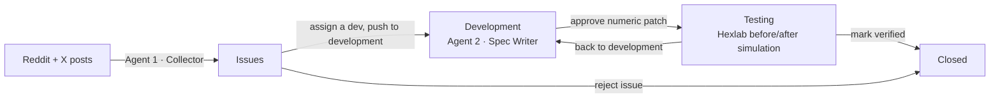

# Pipeline UI

Front end for our Riot Track · Prompt 02 (Agentic Development) project. Agents collect player feedback from Reddit and X, turn the biggest issues into editable change specs, build the change, and check it with bot playtests. A person has to approve every step, because the prompt's rule is *"Verify the result yourself. Don't trust the agent saying it's done."*

Feedback and spec-writing remain a browser prototype. Moving a spec from Development to Testing now calls the real Hexlab simulation API in `tft-clone/` and displays measured before/after results. Existing seeded playtests are labeled illustrative and cannot verify a new change.

## Quick start

```bash
cd ui
npm install        # first time only
npm run dev        # → http://localhost:5173
```

In a second terminal, start the simulation API:

```bash
cd tft-clone
npm install        # first time only
npm run dev:api    # → http://127.0.0.1:3002
```

- Port 5173 is fixed (`strictPort`). Other apps use 5174 (`mockreddit`), 5175 (`mockr`), and 5176 (Hexlab's standalone dashboard).
- Vite proxies `/hexlab-api/*` to `http://127.0.0.1:3002/api/*` in dev and preview. For a separately hosted frontend, set `VITE_HEXLAB_API_URL` in `ui/.env.local` to the simulator's API base URL (ending in `/api`) before building, and configure the simulator's `CORS_ORIGINS` for that frontend.
- `npm run build && npm run preview` serves the production build on 5173 too.
- `npm run lint` runs oxlint (currently clean).
- `npm test` checks API contracts, version binding, retries, result handling, and persistence recovery. With both services running, `HEXLAB_TEST_URL=http://127.0.0.1:5173 npm test` also runs a real API-to-review integration test.

## The flow



| Board column | Issue stage | Issue page | What the person does |
|---|---|---|---|
| **Issues** | Feedback (Identification) | `/issues/:id` | Read the sources, edit tags, assign devs, push to development or reject |
| **Development** | Spec | `/issues/:id/spec` | Edit the `.md` spec or prompt the agent, then approve it |
| **Testing** | Playtest | `/issues/:id/playtest` | Review measured stat changes and gameplay results, then verify or send back |
| **Closed** | Verified (or rejected) | `/issues/:id/verified` | Read-only result; Push to playtest patch (not connected yet) |

Nothing moves on an agent's say-so. Only a person's button press moves an issue.

## Screens

The top bar has two tabs, **Board** (`/`) and **List** (`/list`), plus a light/dark toggle and a **Demo** menu. The old `/feedback` address redirects to `/list`.

### Board (`/`)

The "Work Board": four columns of issue cards, sorted by mentions.

- **Cards** show the title, a 1–3 sentence description, one color dot per tag category used, and a footer.
  - Footer, left: **Queued**, **✓ Verified**, or **✕ Rejected**; cards being worked on show a red ◆ and the assigned devs instead.
  - Footer, right: mention count with a grey ↑.
  - Outline: red while being worked on, amber when an agent run failed.
- **Filters** (all combine):

  | Filter | Options |
  |---|---|
  | Platform | All, Reddit, X |
  | Date | Past hour, today, this week, this month, this year, all time (matched against when the issue was first seen) |
  | Tags | Unit, Trait, Item, Augment, System, Bug fix (any tag of that color; the selected color's dot shows in the dropdown) |
  | Dev | Dev, Jun, Marco, Ana, Priya |

### List (`/list`)

Every issue as a ranked row: rank, title, source counts, mentions, and a 14-day trend line.

- **Sort:** most popular, trending, newest, most recent mention.
- **Filters** (behind *Filters*): source, dev, stage, last mention, game. *Show rejected* brings rejected issues back into the list.
- **Row action:** **Push to development** once a dev is assigned; otherwise **Assign a dev →**, which opens the issue page.
- **⋯ menu:** mark as duplicate / merge into another issue, or reject the issue.

### Issue page

Every issue page has the title (click *Edit* to rename), a **← Board** link, and a stage stepper: **Feedback → Spec → Playtest → Verified**. Steps you can reach are clickable. The current one is marked with a translucent box and a red bar.

#### Feedback (Identification): `/issues/:id`

- **Summary** written by the Collector.
- **Tags**: editable only at this stage (see [Tags](#tags)).
- **Sources**: one pill per platform with its post count. Click a pill to browse that platform's posts in the same box:
  - **← Back**, plus a keyword search
  - infinite scroll, sorted by score, 15 posts at a time
  - each post links to the original in a new tab (empty link until the backend is connected)
  - a failing scraper shows "!" in its pill with **Retry**
- **Does live data back this up?**: the relevant live stat against its healthy range.
- **Mentions per day** chart (with a table view), **Discussion** (comments; `@Name` highlights a dev), and the **Activity log**.
- **Assign to**: a checkbox per dev.
- **Push to development →** stays disabled until a dev is checked.
- **Reject issue** opens a red "Are you sure?" block that asks for a reason. Rejected issues move to Closed and can be restored.

#### Spec (Development): `/issues/:id/spec`

- **Version** dropdown at the top: every version with its author, and "latest" / "approved" markers.
- **spec.md** (default tab): the spec as editable markdown. Saving makes a new version.
- Other tabs: **Summary** (key points and a diagram of affected systems), **Full spec**, **Compare** (diff any two versions), **Edit** (structured form).
- **Ask the Spec Writer** (right side): chat history, quick suggestions, and a prompt box that grows as you type. While the agent rewrites, the editor is read-only and says "Agent is rewriting…".
- **Rollback:** editing or prompting from an older version *k* discards the versions after *k*; the new version becomes *k+1*. The page warns you first.
- **Simulation patch:** attach exact champion, item, or monster numeric edits, inspect baseline values, and choose 100/1,000/5,000/10,000 battles per configuration, seed, and PvP/PvE mode. Unsupported mechanics such as stuns and traits cannot be inferred from prose. Monster edits require PvE.
- **Approve patch & send to Testing** freezes the patch and baseline with its approved spec version and starts the real evaluation. Numeric settings can also be saved as a new version first. Editing `spec.md` alone does not change the executable patch.
- **Request changes** or **Reject spec** requires a comment.

#### Playtest (Testing): `/issues/:id/playtest`

Approving the numeric patch calls Hexlab, which applies edits to a baseline copy and runs identical seeded matchups before and after. This path does not claim to build code, run generated acceptance checks, or permanently modify game files. The page shows:

- **Version** dropdown: every playtest run, labeled like "Spec v2 · run 1 · current" or "Spec v1 · run 1 · rejected". Older runs are read-only.
- **Stat changes tested:** exact baseline values, patched values, and numeric deltas.
- **Performance comparison:** paired baseline/patched bar charts for champion, item, and composition win rates, with measured 95% intervals; a second chart switches between damage dealt, damage taken, and survival time. Zero-sample entities are omitted, and compositions show the eight most-sampled groups. Existing saved real results display these charts without rerunning.
- **Champion performance:** before/after win rates, damage dealt/taken, and time alive, with eligible sample counts and descriptive 95% intervals. Rates are 0–100 percent; rate deltas are percentage points; time is seconds.
- **Item and composition performance**, plus clear rate for PvE. No synthetic convergence series or live-telemetry verdict is added to real results.
- **Watch replays in Hexlab ↗** opens the Hexlab dashboard (`http://127.0.0.1:5176`, override with `VITE_HEXLAB_APP_URL`) on the exact experiment: same baseline, patch, seed, battle count, and mode. Every game can be replayed baseline vs. patched, filtered to the patched champion or to games whose winner changed. Requires the Hexlab dashboard (`npm run dev:web` in `tft-clone`).
- **Re-run** preserves the approved patch, baseline, seed, and mode; only the supported battle count changes. Each completed run is retained.
- **Mark verified** accepts only completed real evidence matching the approved patch. Pending work, failed reruns, stale versions, malformed output, and baseline mismatches block verification.
- **Retry** and **Back to development** recover from failures. Returning to Development ignores late responses; reloading an unfinished request creates an explicit retryable interruption.

Results and human review state use the dashboard's existing localStorage persistence, not shared Supabase workflow tables. Historical results retain their own configuration snapshot. Approximate marginal intervals do not establish that a patch improves balance.

#### Verified: `/issues/:id/verified`

The reviewed simulation, who verified it, and a **Push to playtest patch** button. It's disabled on purpose: deploying isn't connected yet.

## Tags

Two families. The catalog is `TAGS` in `src/data/constants.js`.

**Fix-type tags** are tinted pills. The color says what the fix targets; the icon says which direction.

| Target | Color | Tags |
|---|---|---|
| Unit | blue | ↑ Unit buff · ↓ Unit nerf · ↔ Unit adjust |
| Trait | purple | ↑ Trait buff · ↓ Trait nerf · ↔ Trait adjust |
| Item | gold | ↑ Item buff · ↓ Item nerf · ↔ Item adjust |
| Augment | teal | ↑ Augment buff · ↓ Augment nerf · ↔ Augment adjust |
| System | grey | ⚙ System change |
| Bug fix | pink | ✓ Bug fix |

**Specific tags** are neutral pills with a dot in their target's color:

| Target | Tags in the demo |
|---|---|
| Unit (blue) | Ironvane, Kestrel, Solenne, Brakk, Shield Bash, Skyward Dash, Radiance, Ember skin |
| Trait (purple) | Vanguard, Skirmisher, Support |
| Item (gold) | Harpoon, Scattergun |
| Augment (teal) | Econ augments |
| System (grey) | Map, Economy, Ranked, Matchmaking, Netcode, VFX, UI, Performance, Bench |

To add a tag on the Identification view:
1. Pick **Fix type** or a target.
2. Type a name (catalog names are suggested).
3. Click **+ Add tag**.

Fix types must come from the list. Other names are saved as custom tags for that target. Board cards show one dot per color used; the issue page shows the full pills.

## Demo walkthrough (≈3 minutes)

1. Start the UI and Hexlab API, then open the **Development** card "Evaluate a smaller attack-damage value for Yasuo" (`/issues/iss-hexlab-yasuo/spec`). Existing browser work is preserved when this example is added.
2. Inspect the patch: Yasuo attack damage 25 → 20, seed 42, and 1,000 battles per configuration. Adjust the patch or sample count if desired.
3. Click **Approve patch & send to Testing**. Wait for the actual baseline and patched batches to finish.
4. Review the tested input changes, champion metrics, sample counts, and item/composition details. Rerun with another supported count if needed.
5. **Mark verified**, or return to Development with a comment and revise the patch.

The other seeded issues sit at every stage:
- a spec waiting for review
- a build in progress
- a playtest where the complaint is *not* backed by data
- a verified change
- untriaged issues with and without assigned devs

**Demo menu** (top right):
- Fail the next agent run (shows the error state with Retry)
- Break the Reddit scraper
- Clear issues (shows the empty state)
- Reset demo data

State, including real simulation history, is saved in localStorage under `STORAGE_KEY` (`src/store/reducer.js`). Reset demo data also discards that browser's simulation history. Demo failure controls apply to the remaining simulated agents, not real Hexlab runs.

## Look and feel

Styled after riotgames.com:

- **Type:** Riot Sans for headings; Inter for body text and numbers.
- **Buttons:** red pills whose fill slides to dark on hover.
- **Nav:** small uppercase labels.
- **Colors:** Riot's neutral palette, with red as the only accent.
- **Selection:** hovered and selected items get a translucent rounded box, like Riot's nav (`.sel` in `src/index.css`).
- **Themes:** light and dark. The first visit follows the OS setting; the toggle choice is saved. Tokens for both themes live in `src/index.css`.
- **Accessibility:** status always pairs an icon with a word, charts have text readouts and table views, focus outlines are visible, and everything works by keyboard.

## Project layout

```
ui/
├── index.html              theme is set before first paint (no flash)
├── public/                 favicon, Riot Sans font files
└── src/
    ├── App.jsx             top bar, routes, Demo menu
    ├── index.css           theme tokens, Riot button, tag pills, selection style
    ├── data/
    │   ├── constants.js    stages, board columns, statuses, agents, tags, devs
    │   ├── seed.js         demo issues, posts, stats, tags, assignments
    │   └── generators.js   stand-ins for agent output: specs, builds, playtests, posts
    ├── store/
    │   ├── reducer.js      every pipeline action + simulated agent runs
    │   └── pipeline.jsx    provider, agent tick, localStorage persistence
    ├── hooks/
    │   ├── useAgentStream.js   live agent status for an issue (swap for SSE/WebSocket)
    │   └── useTheme.js         light/dark
    ├── components/         tags, stepper, approval gate, sources browser, charts, diff, build summary…
    └── pages/
        ├── Board.jsx       Work Board
        ├── List.jsx        ranked list
        ├── IssueLayout.jsx title, stepper, ← Board
        ├── IssueDetail.jsx Feedback / Identification
        ├── SpecWorkspace.jsx
        └── PlaytestResults.jsx  Playtest and Verified
```

Stack: Vite 8 · React 19 · React Router 7 · Tailwind CSS 4 · Recharts · react-diff-viewer-continued.

## Connecting the real backend

- **Simulation:** already connected through `src/simulation/client.js`. Real runs use `kind: 'simulation'`, contain a frozen request/configuration snapshot, and resolve through explicit success/failure actions rather than timer ticks. `spec.simulation` is the structured handoff for future backend-supplied specs.
- **Persistence:** move simulation requests, results, and review decisions from localStorage to authoritative backend storage when shared workflow persistence is implemented.
- **Agents:** replace the reducer's simulated `run` (and `useAgentStream`) with server events. Keep the shapes (`Issue`, `specVersions[]`, `build`, `builds[]`, `playtest`, `playtests[]`) and the UI keeps working. Everything is keyed by issue ID.
- **Posts:** swap `makeClusterPosts` for a paginated `GET /issues/:id/posts?platform=&q=&cursor=` sorted by score, and fill in each post's link.
- **Gate:** the "at least one dev assigned" rule is enforced in the reducer (`SEND_TO_SPEC`), not only in the buttons. Keep it server-side too.

## Not done yet

- **Push to playtest patch** is a disabled button; no deploy is wired up.
- Cards don't animate when they change columns.
- The Tags dropdown's open list can't show color dots (it's the browser's native list).
- Demo data uses two fictional games (Shardfall, Tidebreak) instead of TFT data.

## Riot assets

The logo (`src/components/RiotLogo.jsx` and `public/riot-logo.svg`) and the Riot Sans font files in `public/fonts/` were copied from riotgames.com. Riot Sans is a proprietary typeface. Confirm with the Riot track organizers that using both is OK. If not, delete `public/fonts/`; headings fall back to Inter.
