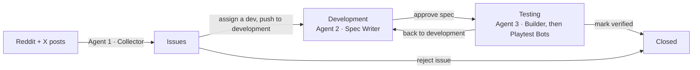

# Pipeline UI

Front end for our Riot Track · Prompt 02 (Agentic Development) project. Agents collect player feedback from Reddit and X, turn the biggest issues into editable change specs, build the change, and check it with bot playtests. A person has to approve every step, because the prompt's rule is *"Verify the result yourself. Don't trust the agent saying it's done."*

This is a working prototype. Issues are loaded from a Supabase backend; agent output, posts, and playtest results are still simulated in the browser, so the whole flow can be demoed with just the issue data in Supabase.

## Quick start

```bash
cd ui
npm install        # first time only
cp .env.example .env.local   # then fill in the Supabase keys (see below)
npm run dev        # → http://localhost:5173
```

- Port 5173 is fixed (`strictPort`). The other apps in this repo use 5174 (`mockreddit`) and 5175 (`mockr`).
- `npm run build && npm run preview` serves the production build on 5173 too.
- `npm run lint` runs oxlint (currently clean).

## Supabase

Issues come from a Supabase project. The app reads from the shared `issues`
table and a UI-owned companion table on load; the client-side agent simulation
runs on top of that for now (see [Connecting the real backend](#connecting-the-real-backend)).

### Environment

Create `ui/.env.local` (gitignored) with the project's publishable/anon key:

```
VITE_SUPABASE_URL=https://<project>.supabase.co
VITE_SUPABASE_ANON_KEY=sb_publishable_...
# Server-side only, for the one-time data push (never shipped to the browser):
SUPABASE_SERVICE_ROLE_KEY=sb_secret_...
```

If `VITE_SUPABASE_URL` / `VITE_SUPABASE_ANON_KEY` are missing, the app falls
back to the in-browser seed (offline/demo mode) instead of Supabase.

### Schema and data (`supabase/`)

Issues live in the existing run-centric schema (`runs`, `issues`, …). The UI
needs display state those tables don't carry (stage, status, tags, devs, spec
versions, builds, playtests, comments, audit), so we add three companion tables.
Run these once, in the Supabase SQL Editor, in order:

1. `supabase/ui_tables.sql` — creates `ui_issue_meta` (1:1 with `issues`),
   `ui_source_status`, `ui_ingest`; enables RLS with anon read/write policies.
2. `supabase/ui_grants.sql` — grants table privileges to the API roles.

Then push the seed data (uses the service-role key from `.env.local`, bypasses
RLS, idempotent):

```bash
node --loader ./supabase/ext-resolver.mjs supabase/push-seed.mjs
```

It writes one anchor `runs` row, maps each seed issue onto the real `issues`
columns, and stores the UI-only fields in `ui_issue_meta`. The existing
`issues.target_type` only allows `unit | trait`, so other targets (item,
system, bug) are stored as `unit`; the full tag set is preserved in
`ui_issue_meta.tags`, which is what the UI renders.

Sanity-check reads through the anon key with
`node supabase/verify-read.mjs`.

## The flow



| Board column | Issue stage | Issue page | What the person does |
|---|---|---|---|
| **Issues** | Feedback (Identification) | `/issues/:id` | Read the sources, edit tags, assign devs, push to development or reject |
| **Development** | Spec | `/issues/:id/spec` | Edit the `.md` spec or prompt the agent, then approve it |
| **Testing** | Playtest | `/issues/:id/playtest` | Review the simulated results, then verify or send back |
| **Closed** | Verified (or rejected) | `/issues/:id/verified` | Read-only result; Push to playtest patch (not connected yet) |

Nothing moves on an agent's say-so. Only a person's button press moves an issue.

## Screens

The top bar has two tabs, **Board** (`/`) and **List** (`/list`), plus a light/dark toggle and a **Demo** menu. The old `/feedback` address redirects to `/list`.

### Board (`/`)

The "Work Board": four columns of issue cards, sorted by mentions.

- **Cards** show the title, a 1–3 sentence description, one color dot per tag category used, and a footer.
  - Footer, left: **Queued**, **✓ Verified**, or **✕ Rejected**; cards being worked on show a red ◆ and the assigned devs instead.
  - Footer, right: mention count with a grey ↑.
  - Outline: red while being worked on, amber when an agent run failed.
- **Filters** (all combine):

  | Filter | Options |
  |---|---|
  | Platform | All, Reddit, X |
  | Date | Past hour, today, this week, this month, this year, all time (matched against when the issue was first seen) |
  | Tags | Unit, Trait, Item, Augment, System, Bug fix (any tag of that color; the selected color's dot shows in the dropdown) |
  | Dev | Dev, Jun, Marco, Ana, Priya |

### List (`/list`)

Every issue as a ranked row: rank, title, source counts, mentions, and a 14-day trend line.

- **Sort:** most popular, trending, newest, most recent mention.
- **Filters** (behind *Filters*): source, dev, stage, last mention, game. *Show rejected* brings rejected issues back into the list.
- **Row action:** **Push to development** once a dev is assigned; otherwise **Assign a dev →**, which opens the issue page.
- **⋯ menu:** mark as duplicate / merge into another issue, or reject the issue.

### Issue page

Every issue page has the title (click *Edit* to rename), a **← Board** link, and a stage stepper: **Feedback → Spec → Playtest → Verified**. Steps you can reach are clickable. The current one is marked with a translucent box and a red bar.

#### Feedback (Identification): `/issues/:id`

- **Summary** written by the Collector.
- **Tags**: editable only at this stage (see [Tags](#tags)).
- **Sources**: one pill per platform with its post count. Click a pill to browse that platform's posts in the same box:
  - **← Back**, plus a keyword search
  - infinite scroll, sorted by score, 15 posts at a time
  - each post links to the original in a new tab (empty link until the backend is connected)
  - a failing scraper shows "!" in its pill with **Retry**
- **Does live data back this up?**: the relevant live stat against its healthy range.
- **Mentions per day** chart (with a table view), **Discussion** (comments; `@Name` highlights a dev), and the **Activity log**.
- **Assign to**: a checkbox per dev.
- **Push to development →** stays disabled until a dev is checked.
- **Reject issue** opens a red "Are you sure?" block that asks for a reason. Rejected issues move to Closed and can be restored.

#### Spec (Development): `/issues/:id/spec`

- **Version** dropdown at the top: every version with its author, and "latest" / "approved" markers.
- **spec.md** (default tab): the spec as editable markdown. Saving makes a new version.
- Other tabs: **Summary** (key points and a diagram of affected systems), **Full spec**, **Compare** (diff any two versions), **Edit** (structured form).
- **Ask the Spec Writer** (right side): chat history, quick suggestions, and a prompt box that grows as you type. While the agent rewrites, the editor is read-only and says "Agent is rewriting…".
- **Rollback:** editing or prompting from an older version *k* discards the versions after *k*; the new version becomes *k+1*. The page warns you first.
- **Approve vN & send to playtest**, **Request changes**, or **Reject spec** (a comment is required for the last two).

#### Playtest (Testing): `/issues/:id/playtest`

1. Approving the spec starts the **Builder** in the background (no separate build page). Its log streams at the top.
2. If a check fails, the Builder retries on its own, up to 3 attempts. After that, the page shows the error with **Retry** and **Back to spec**.
3. Once every check passes, **Playtest Bots** play 2,000 matches with 8 bot players each.

Then the page shows, top to bottom:

- **Version** dropdown: every playtest run, labeled like "Spec v2 · run 1 · current" or "Spec v1 · run 1 · rejected". Older runs are read-only.
- **Stat cards**: matches run, avg damage dealt, avg time alive (each with "was …").
- **Win rate per team comp**: before (grey) and after (red) bars per comp, each with a readout like `50.9% → 52.6% (+1.7%)`, and a table view.
- **Verdict**: was the complaint backed by live stats, and did the change move the metric toward its target?
- The headline metric, a convergence chart, and a **Re-run** control (200 to 5,000 matches).
- **Mark verified** or **← Back to development** (reverts the change; comment required).
- **Code change** (collapsed): what the Builder claimed, each check, earlier failed attempts, and the file diff.

#### Verified: `/issues/:id/verified`

The final result, who verified it, the code change, and a **Push to playtest patch** button. It's disabled on purpose: deploying isn't connected yet.

## Tags

Two families. The catalog is `TAGS` in `src/data/constants.js`.

**Fix-type tags** are tinted pills. The color says what the fix targets; the icon says which direction.

| Target | Color | Tags |
|---|---|---|
| Unit | blue | ↑ Unit buff · ↓ Unit nerf · ↔ Unit adjust |
| Trait | purple | ↑ Trait buff · ↓ Trait nerf · ↔ Trait adjust |
| Item | gold | ↑ Item buff · ↓ Item nerf · ↔ Item adjust |
| Augment | teal | ↑ Augment buff · ↓ Augment nerf · ↔ Augment adjust |
| System | grey | ⚙ System change |
| Bug fix | pink | ✓ Bug fix |

**Specific tags** are neutral pills with a dot in their target's color:

| Target | Tags in the demo |
|---|---|
| Unit (blue) | Ironvane, Kestrel, Solenne, Brakk, Shield Bash, Skyward Dash, Radiance, Ember skin |
| Trait (purple) | Vanguard, Skirmisher, Support |
| Item (gold) | Harpoon, Scattergun |
| Augment (teal) | Econ augments |
| System (grey) | Map, Economy, Ranked, Matchmaking, Netcode, VFX, UI, Performance, Bench |

To add a tag on the Identification view:
1. Pick **Fix type** or a target.
2. Type a name (catalog names are suggested).
3. Click **+ Add tag**.

Fix types must come from the list. Other names are saved as custom tags for that target. Board cards show one dot per color used; the issue page shows the full pills.

## Demo walkthrough (≈3 minutes)

1. **List**: "Ironvane's Shield Bash stun lasts too long" is #1. Optionally merge "Ironvane stun is broken" into it from the ⋯ menu.
2. Open it. Browse the Reddit and X posts in **Sources** and check the live-stat sanity check. Priya is already checked under **Assign to**, so click **Push to development →**.
3. **Spec**: watch the Spec Writer draft it, then ask it to "Make this a smaller nerf" or edit `spec.md`. Switch versions with the dropdown.
4. **Approve & send to playtest**. The Builder's first attempt says "done" but fails the *Tooltip ↔ data sync* check, so it retries. Attempt 2 passes and the bots start.
5. Read the stat cards, comp bars, and verdict. Click **Mark verified** to land on the Verified page.

The other seeded issues sit at every stage:
- a spec waiting for review
- a build in progress
- a playtest where the complaint is *not* backed by data
- a verified change
- untriaged issues with and without assigned devs

**Demo menu** (top right):
- Fail the next agent run (shows the error state with Retry)
- Break the Reddit scraper
- Clear issues (shows the empty state)
- Reset demo data

Demo state is saved in the browser's localStorage under `STORAGE_KEY` (`src/store/reducer.js`). Bumping that key resets everyone's saved demo.

## Look and feel

Styled after riotgames.com:

- **Type:** Riot Sans for headings; Inter for body text and numbers.
- **Buttons:** red pills whose fill slides to dark on hover.
- **Nav:** small uppercase labels.
- **Colors:** Riot's neutral palette, with red as the only accent.
- **Selection:** hovered and selected items get a translucent rounded box, like Riot's nav (`.sel` in `src/index.css`).
- **Themes:** light and dark. The first visit follows the OS setting; the toggle choice is saved. Tokens for both themes live in `src/index.css`.
- **Accessibility:** status always pairs an icon with a word, charts have text readouts and table views, focus outlines are visible, and everything works by keyboard.

## Project layout

```
ui/
├── index.html              theme is set before first paint (no flash)
├── public/                 favicon, Riot Sans font files
└── src/
    ├── App.jsx             top bar, routes, Demo menu
    ├── index.css           theme tokens, Riot button, tag pills, selection style
    ├── data/
    │   ├── constants.js    stages, board columns, statuses, agents, tags, devs
    │   ├── seed.js         demo issues, posts, stats, tags, assignments (seed source for the push + offline fallback)
    │   ├── generators.js   stand-ins for agent output: specs, builds, playtests, posts
    │   └── supabase.js     browser client + loadStateFromSupabase() (issues + ui_* → UI shape)
    ├── store/
    │   ├── reducer.js      every pipeline action + simulated agent runs (HYDRATE loads Supabase state)
    │   └── pipeline.jsx    provider; loads from Supabase on mount, agent tick
    ├── hooks/
    │   ├── useAgentStream.js   live agent status for an issue (swap for SSE/WebSocket)
    │   └── useTheme.js         light/dark
    ├── components/         tags, stepper, approval gate, sources browser, charts, diff, build summary…
    └── pages/
        ├── Board.jsx       Work Board
        ├── List.jsx        ranked list
        ├── IssueLayout.jsx title, stepper, ← Board
        ├── IssueDetail.jsx Feedback / Identification
        ├── SpecWorkspace.jsx
        └── PlaytestResults.jsx  Playtest and Verified
```

Stack: Vite 8 · React 19 · React Router 7 · Tailwind CSS 4 · Recharts · react-diff-viewer-continued.

## Connecting the real backend

**Done:** issues load from Supabase on startup (`src/data/supabase.js` →
`loadStateFromSupabase()`, dispatched as `HYDRATE` in `pipeline.jsx`). Supabase
is the only source of issues; there's no mock fallback when it's configured.
Still in the browser: the agent simulation and all write actions.

Remaining to go fully server-backed:

- **Writes:** reducer actions (`SEND_TO_SPEC`, `SPEC_APPROVE`, `PLAYTEST_VERIFY`, …) still mutate local state only. Persist each to Supabase (and ideally subscribe to realtime changes to replace the local `TICK`).
- **Agents:** replace the reducer's simulated `run` (and `useAgentStream`) with server events. Keep the shapes (`Issue`, `specVersions[]`, `build`, `builds[]`, `playtest`, `playtests[]`) and the UI keeps working. Everything is keyed by issue ID.
- **Posts:** swap `makeClusterPosts` for a paginated `GET /issues/:id/posts?platform=&q=&cursor=` sorted by score, and fill in each post's link. (The existing `feedback_posts` table is the likely source.)
- **Gate:** the "at least one dev assigned" rule is enforced in the reducer (`SEND_TO_SPEC`), not only in the buttons. Keep it server-side too.

## Not done yet

- **Push to playtest patch** is a disabled button; no deploy is wired up.
- Cards don't animate when they change columns.
- The Tags dropdown's open list can't show color dots (it's the browser's native list).
- Demo data uses two fictional games (Shardfall, Tidebreak) instead of TFT data.

## Riot assets

The logo (`src/components/RiotLogo.jsx` and `public/riot-logo.svg`) and the Riot Sans font files in `public/fonts/` were copied from riotgames.com. Riot Sans is a proprietary typeface. Confirm with the Riot track organizers that using both is OK. If not, delete `public/fonts/`; headings fall back to Inter.
